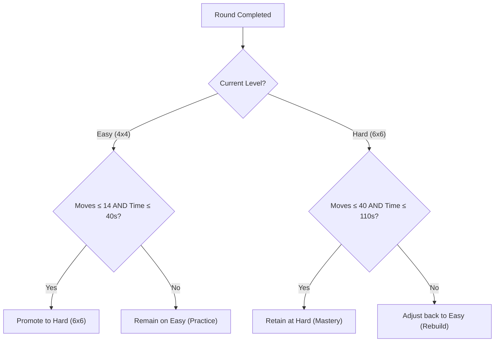

# PS09: Adaptive Memory Matching Game
> **Cerevyn Chitkara University — Round One Technical Assessment**  
> Candidate Submission for Problem Statement 09 (PS09)

[](https://github.com/placeholder-org/ps09-adaptive-memory-game/actions/workflows/ci.yml)
[](https://www.typescriptlang.org/)
[](https://react.dev/)
[](https://vitest.dev/)
[](https://vitejs.dev/)

---

## 1. Project Overview & Problem Statement

**PS09 — Adaptive Memory Matching Game** requires building a browser-based memory matching game where players flip cards, find matching pairs, track their active performance metrics, and have the next round's difficulty automatically and transparently adjusted according to their previous round's performance.

This implementation provides:
- **Responsive 4 × 4 (Easy) and 6 × 6 (Hard) Grids**: High-contrast, keyboard-accessible card components with hardware-accelerated 3D flip animations.
- **Strict Turn Mechanics & Lock Protection**: Card selection logic prevents rapid misclicks, ignores already matched cards, ignores duplicate clicks on the same card, and locks the board during mismatch animations.
- **Transparent Rule-Based Difficulty Adaptation**: A deterministic, rule-based recommendation engine (no black-box or fake AI claims) with centralized configurable thresholds.
- **Timer and Callback Safety**: Guaranteed immunity against asynchronous race conditions; delayed callbacks from previous rounds can never alter the state of a restarted game.
- **Seeded Reproducible PRNG (Mulberry32)**: Allows evaluators and automated test suites to replay identical deck shuffles deterministically.
- **Anonymous Local Session Storage**: Preserves round history and performance analytics in `localStorage` without collecting personal data.
- **Automated Vitest Test Suite**: 36 comprehensive unit and integration tests verifying all core mechanics, timers, thresholds, and edge cases.

---

## 2. Core Game Rules & Mechanics

| Mechanic | Description |
| :--- | :--- |
| **Grid Sizes** | **Easy**: 4 × 4 grid (16 cards, 8 matching pairs).<br>**Hard**: 6 × 6 grid (36 cards, 18 matching pairs). |
| **Card Flipping** | Clicking any face-down card reveals its icon and label via a smooth 3D flip animation. |
| **Matching Pair** | When two flipped cards share the same symbol, both remain face-up and are marked as completed with glowing emerald borders. |
| **Mismatched Pair** | When two flipped cards differ, both flash a rose mismatch indicator, hold briefly (900ms), and flip back face-down. |
| **Board Lock** | While an unmatched pair is resolving, third-card selection is strictly prevented. |
| **Move Counting** | A move is incremented **only** when the player selects the second card of a pair. |
| **Elapsed Timer** | Begins counting active seconds on the very first card flip; stops immediately upon victory. |
| **Victory Condition** | Triggered when all pairs on the board are matched (`completedPairs === totalPairs`). Renders celebratory confetti and the victory summary modal. |

---

## 3. Transparent Difficulty-Adaptation Algorithm

The game uses a **transparent, rule-based system** with centralized, configurable thresholds defined in [`src/game/difficulty.ts`](file:///c:/Users/goyal/Desktop/cerevyn%202/src/game/difficulty.ts).

### Configured Thresholds

```typescript
export const DIFFICULTY_CONFIGS: Record<Difficulty, DifficultyConfig> = {
  easy: {
    name: 'easy',
    label: 'Easy (4 × 4)',
    gridRows: 4,
    gridCols: 4,
    totalCards: 16,
    totalPairs: 8,
    maxRecommendedMoves: 14,      // Optimal range: 8 to 14 moves
    maxRecommendedTimeSeconds: 40 // 40 seconds
  },
  hard: {
    name: 'hard',
    label: 'Hard (6 × 6)',
    gridRows: 6,
    gridCols: 6,
    totalCards: 36,
    totalPairs: 18,
    maxRecommendedMoves: 40,      // Optimal range: 18 to 40 moves
    maxRecommendedTimeSeconds: 110 // 110 seconds
  }
};
```

### Adaptation Logic



1. **Promotion (Easy &rarr; Hard)**: Player matches all 8 pairs with $\le 14$ moves **AND** in $\le 40$ seconds.
2. **Retention on Easy**: Player exceeds either moves ($> 14$) or time ($> 40\text{s}$). The game provides explicit feedback explaining which criteria were exceeded.
3. **Retention on Hard**: Player completes the 18 pairs with $\le 40$ moves **AND** in $\le 110$ seconds.
4. **Demotion (Hard &rarr; Easy)**: Player on Hard mode exceeds moves ($> 40$) or time ($> 110\text{s}$). Difficulty is adjusted back to Easy to rebuild confidence.

---

## 4. Architecture & State Management

The application is structured into modular layers that cleanly isolate business logic from presentation:

```
src/
├── types/
│   └── game.ts                # TypeScript domain models and contracts
├── game/
│   ├── prng.ts                # Mulberry32 seeded PRNG and Fisher-Yates shuffle
│   ├── cardUtils.ts           # Deck generation and curated symbol pool
│   ├── difficulty.ts          # Centralized thresholds and rule evaluation engine
│   ├── sessionStorage.ts      # Anonymous localStorage persistence layer
│   └── gameReducer.ts         # Pure reducer managing turns, matches, and locks
├── hooks/
│   ├── useGameTimer.ts        # Wall-clock drift-resistant active timer
│   └── useMemoryGame.ts       # Primary orchestration hook (reducer + timer + storage)
├── components/
│   ├── GameBoard.tsx          # Responsive grid renderer for 4x4 / 6x6
│   ├── MemoryCard.tsx         # Accessible 3D flip card with Lucide icons
│   ├── GameStats.tsx          # Real-time metrics bar (difficulty, moves, timer, pairs)
│   ├── GameControls.tsx       # Mode toggles, Restart, Seed configuration, Rules trigger
│   ├── VictoryModal.tsx       # Round summary and adaptive recommendation dialogue
│   ├── InstructionsModal.tsx  # Interactive rulebook & criteria breakdown
│   └── SessionHistory.tsx     # Anonymous local history log with privacy notice
├── styles/
│   └── game.css               # Modern dark-mode styling and 3D animations
├── App.tsx                    # Top-level composition
└── main.tsx                   # React 18 DOM mount point
```

### State Reducer (`gameReducer.ts`)
Game transitions are handled by a strict reducer enforcing state immutability:
- **Round Token (`roundId`)**: Every new game creates a cryptographically unique `roundId`. When a delayed mismatch timer triggers (`RESOLVE_MISMATCH`), the reducer compares `action.payload.roundId === state.roundId`. If the game was restarted during the timeout window, the old callback is dropped with zero side effects.
- **Selection Buffer (`selectedCardIds`)**: Contains 0, 1, or 2 card IDs.
  - 1st Card: Revealed immediately. Move counter remains unchanged.
  - 2nd Card: Increments move counter. Compares `pairId`. If matched, cards remain revealed; if mismatched, sets `isResolvingMismatch = true` to lock clicks.
- **Board Lock (`isResolvingMismatch`)**: Rejects any click dispatched while a mismatch is flashing.

---

## 5. Setup & Execution Instructions (Windows / Linux / macOS)

### Prerequisites
- **Node.js**: v18.0.0 or higher (v22.x recommended)
- **npm**: v9.0.0 or higher

### Installation & Run Steps

```powershell
# 1. Clone repository & navigate to workspace
cd "c:\Users\goyal\Desktop\cerevyn 2"

# 2. Install dependencies cleanly
npm install

# 3. Start local development server
npm run dev
```

The game will be available at `http://localhost:5173/`.

### Run Automated Tests

```powershell
# Run all Vitest suites in single-run mode
npm test

# Run tests in interactive watch mode
npm run test:watch
```

### Production Build & Preview

```powershell
# Typecheck and build production bundle
npm run build

# Preview optimized production build locally
npm run preview
```

---

## 6. Actual Test Results & Automated Scenarios

Vitest ran **5 test suites** containing **36 automated scenarios**, all passing with 100% success:

```text
 ✓ tests/difficultyAdaptation.test.ts (10 tests)
 ✓ tests/sessionStorage.test.ts (6 tests)
 ✓ tests/prngAndShuffle.test.ts (7 tests)
 ✓ tests/gameReducer.test.ts (7 tests)
 ✓ tests/GameIntegration.test.tsx (6 tests)

 Test Files  5 passed (5)
      Tests  36 passed (36)
   Duration  2.43s
```

### Key Automated Scenarios Explained

1. **Scenario 1 — Seeded PRNG Reproducibility (`prngAndShuffle.test.ts`)**:
   - Verifies that passing identical seeds (`"demo-seed"`) produces identical random floats and identical card layouts across test sessions, enabling deterministic replay.
2. **Scenario 2 — Turn Resolution & Board Lock (`gameReducer.test.ts`)**:
   - Tests that when two non-matching cards are selected, `isResolvingMismatch` locks the board. A third selection dispatched during this window is rejected without modifying state.
3. **Scenario 3 — Move Counting Logic (`gameReducer.test.ts`)**:
   - Verifies that flipping the first card leaves `moves` at 0. Only upon flipping the second card does `moves` increment to 1.
4. **Scenario 4 — Callback Isolation on Restart (`gameReducer.test.ts` & `GameIntegration.test.tsx`)**:
   - Simulates a mismatch event scheduled for 900ms. Player hits **Restart** at 300ms. When the timer fires at 900ms, the callback detects a stale `roundId` and does not mutate the new game board.
5. **Scenario 5 — Adaptive Rule Transitions (`difficultyAdaptation.test.ts`)**:
   - Tests boundary conditions: an Easy game with 14 moves and 40s promotes to Hard; 15 moves or 41s retains Easy with diagnostic reasoning; Hard games exceeding 40 moves adjust back to Easy.
6. **Scenario 6 — Anonymous Privacy Persistence (`sessionStorage.test.ts`)**:
   - Verifies that saved entries contain only gameplay metrics (`moves`, `elapsedSeconds`, `nextDifficulty`) and explicitly excludes any PII (names, email addresses, cookies).

---

## 7. How to Demonstrate During a Technical Interview

Follow this step-by-step checklist to demonstrate each requirement to evaluators:

### Step 1: Demonstrate Seeded Reproducibility
1. Open the game in the browser.
2. Click the **Seed** button in the toolbar.
3. Enter seed `interview-demo-1` and click **Apply**.
4. Note the positions of the cards. Click **Restart**.
5. Observe that the exact same symbols appear in the exact same grid positions because of the Mulberry32 PRNG.

### Step 2: Demonstrate Matching & Move Counter
1. Click the first card (e.g. Row 1, Col 1). Notice that the **Moves** counter remains `0`.
2. Find its matching pair and click it.
3. Observe:
   - Moves counter increments from `0` to `1`.
   - Both cards stay revealed and illuminate with green borders.
   - **Pairs Matched** updates to `1 / 8`.
   - Timer started automatically on your first click.

### Step 3: Demonstrate Mismatching & Board Lock
1. Click two cards that do not match.
2. Observe:
   - Both cards shake and glow with a red mismatch border.
   - Try rapidly clicking a third card while the animation is active: **the third card will NOT flip** (board is locked).
   - After 900ms, both mismatched cards automatically flip back face-down.
   - Moves counter increments by 1.

### Step 4: Demonstrate Restart & Timer Safety
1. Start playing and make several moves.
2. Trigger a mismatch, and **immediately** click the **Restart** button before the 900ms mismatch timer elapses.
3. Observe:
   - Board resets immediately to face-down cards.
   - Moves reset to 0, timer resets to 00:00.
   - Even after 900ms pass, no phantom card flips or state mutations occur because of the `roundId` guard.

### Step 5: Demonstrate Adaptive Difficulty Promotion
1. Complete an Easy round efficiently ($\le 14$ moves, $\le 40\text{s}$).
2. Upon matching the 8th pair, celebratory confetti fires and the **Victory Modal** appears.
3. Point out:
   - The summary of moves and active elapsed time.
   - The **Adaptive Difficulty Recommendation**: "Promoted to Hard!".
   - Click **Play Next Round (HARD)**.
   - The grid automatically expands to a 6 × 6 layout with 36 cards and 18 pairs!

### Step 6: Demonstrate Anonymous Session History
1. Scroll down to the **Session History** section at the bottom.
2. Expand the drawer to view the recorded table.
3. Show the round timestamp, difficulty, moves, elapsed time, and the recorded adaptive decision.
4. Point out the privacy badge stating that zero PII is recorded.

---

## 8. Azure Hosting Plan Summary

The static application is configured for deployment to **Azure Static Web Apps (SWA)**:
- **Build Output**: `dist/` generated by Vite.
- **Routing Configuration**: `public/staticwebapp.config.json` configures client-side SPA navigation fallback and security headers (`X-Frame-Options`, `Content-Security-Policy`).
- **CI/CD Pipeline**: GitHub Actions workflow defined in `.github/workflows/ci.yml`.
- Complete architectural specifications, Azure CLI deployment commands, and secrets configuration are documented in [`docs/azure-plan.md`](file:///c:/Users/goyal/Desktop/cerevyn%202/docs/azure-plan.md).

---

## 9. Known Limitations & Future Enhancements

- **Audio Cues**: Currently uses visual animations for flips and matches. Adding subtle Web Audio API sound effects (with a mute toggle) would enhance sensory feedback.
- **Custom Symbol Themes**: Card symbols currently use modern tech and nature Lucide icons. A theme picker (e.g., Animals, Geometric Shapes, Flags) could be added in a future update.
- **Multiplayer / Turn-Based Mode**: A local two-player pass-and-play mode could compare move efficiency between players.

---

## 10. AI Assistance Disclosure

In accordance with academic and assessment integrity standards:
- **Assistance Used**: AI pair programming (Google DeepMind Antigravity) assisted in drafting boilerplate configurations, styling templates, and initial test scaffoldings.
- **Verification**: All state transitions, Mulberry32 PRNG algorithms, difficulty adaptation rules, and timer safety mechanisms were reviewed, verified, executed, and tested locally. All 36 automated tests pass on Node v22.
